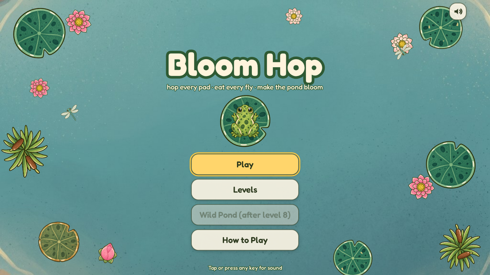
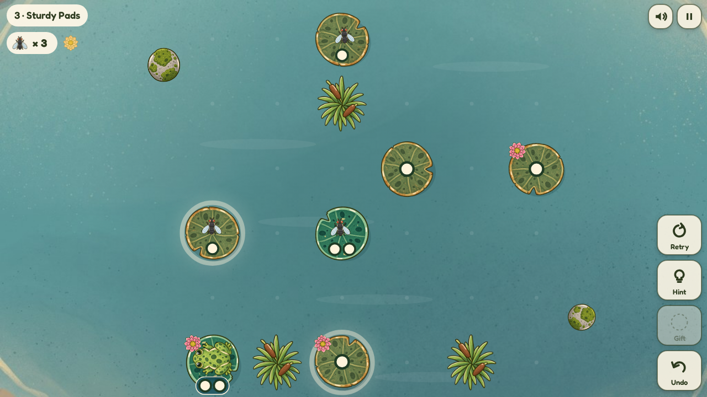
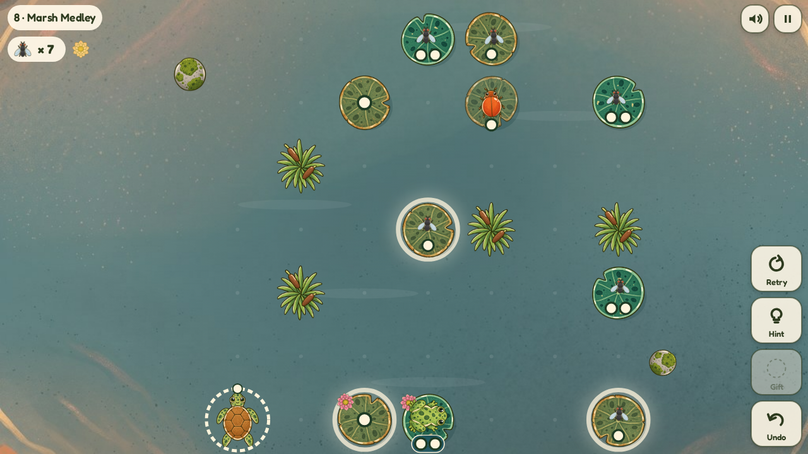
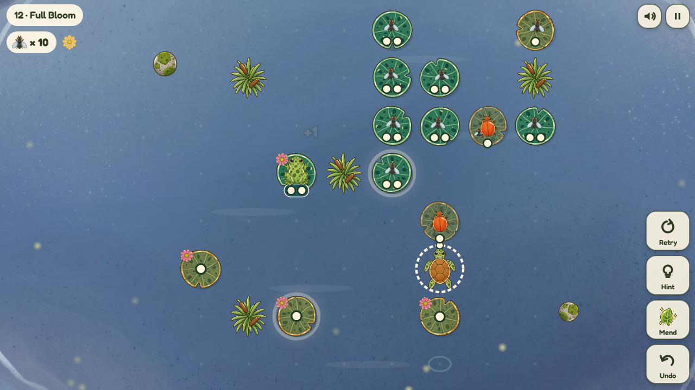
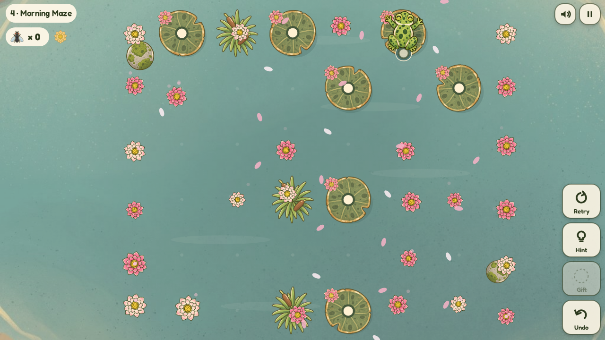
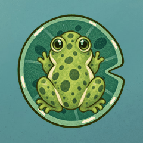
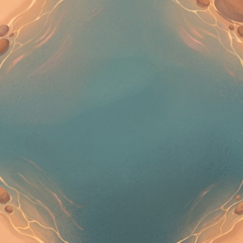
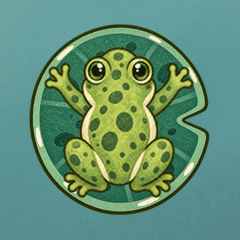

# Bloom Hop

*Hop every pad, eat every fly, and make the whole pond bloom.*

You're a hungry little frog on a lily pond. Every pad has a fly on it, and
every pad can only take so many hops before it sinks behind you. Plan your
route, flick grumpy beetles out of the way with your tongue, ride turtles before
they dive, and catch gifts from friendly koi. Gulp down the last fly and the
whole pond bursts into flower while your frog does a happy little dance.

**[▶ Play Bloom Hop](https://bloomhop.synapticnoise.com)** in your browser. No
install, works on desktop and on phones.



## The ponds

| | |
|---|---|
|  **Morning Pond.** Learn to hop, leap over open water, and plan around sturdy pads that take two or three hops. |  **Sunset Marsh.** Turtles that surface and dive, beetles that hog pads, and koi with presents. |
|  **Moonlit Lagoon.** Bigger ponds with everything at once, under the fireflies. |  **The bloom.** Clear a pond and lotus flowers open across it. |

Twelve puzzles, and every one is guaranteed beatable: each pond is built by
actually walking a frog through it, then a solver checks it again. Finish
level 8 to unlock **Wild Pond**, 150 more ponds that keep getting trickier and
then come back mirrored and spun around, so the pond never runs dry.

## The pond folk


- **Lily pads.** The dots show how many more hops a pad can take. Hop off
  and it loses a dot. At zero, *bloop*, it sinks. Sunk pads can be hopped
  right over.
- **Flies.** One on every pad. Eat them all to win.
- **Beetles.** They sit on pads you need. Flick them with your tongue and
  they scuttle to the next pad along (a dotted arrow shows where).
- **Turtles.** Free stepping stones, but they dive on a rhythm. The ring of
  dots shows how many moves a turtle will hold you; red means *you'll get wet!*
- **Koi.** Land next to a ripple and a koi leaps out with a gift: a **Mend
  Leaf** that patches your pad, or a **Gold Feather** for one long leap.

## How to play

- **Hop:** arrow keys or WASD, or click or tap a glowing pad. On a phone you
  can swipe, too. You always land on the first pad in line, up to three cells
  away.
- **Tongue:** Shift + arrow (or Space, then an arrow), or tap a beetle.
- **Power-up:** E, or the gift button.
- **Undo:** Z, as many times as you like. **Retry:** R (and Undo takes it
  back). **Hint:** H.
- **Pause:** Esc or P. **Mute:** M.
- On a phone, the buttons sit below the pond, or beside it when you hold the
  phone sideways. You can install it from your browser's menu to play full
  screen, even offline.

There's no game over here, only Undo. Win a pond without a hint to earn a
**gold flower**. Your progress is saved in your browser.

## How it was made

The whole game was made by [Claude Code](https://claude.com/claude-code) with
**[gamegen](https://github.com/zeveck/gamegen)**, a Claude Code plugin that
turns an idea into a finished game. The design, the 162 levels, the art, the
animation, the music, the sound effects and every line of code came from this
one command:

> /gg:gamegen Make an overhead puzzle game in which you're a frog hopping from lilipad to lilipad and each one can only handle so many hops before it sinks and the goal is to hop on every lilipad, perhaps each one has a fly on it or something, and there's music and maybe a dozen level that get harder as you go. They can be generated, but, should always be possible to beat. You could also use your tongue to nudge enemies or something. There could also be turtle pads that surface and sink or fish that come up and give you power ups. When you hop to every lilipad flowers around the level all bloom and you celebrate before moving on.

That's it: no other instructions, no hand-drawn art, no hand-written code.
From there, gamegen wrote a design, had a team of reviewer agents (a player,
a builder and an art director) pick it apart over two rounds, then generated the art and
audio, built the game, play-tested every level on desktop and phone sizes, and
had a fresh playtester and bug hunter go over the result. The levels come from
a generator that walks the frog through each pond so a winning route always
exists, and `node tools/verify-levels.mjs` re-checks all 162 ponds.

gamegen brings four plugins along. Here's what each one made.

### [imagegen2](https://github.com/zeveck/imagegen2): the pond folk



imagegen2 creates images with OpenAI's GPT Image. It drew the frog first, and
the frog then set the style for everything else: the lily pads (fresh, worn
and tattered), the flies, beetles, turtle, koi, lotus flowers, power-ups,
reeds and the app icon.

<br clear="right">

### [nanogen](https://github.com/zeveck/nanogen): the water



nanogen creates images with Google's Gemini (Nano Banana). It painted the open
pond for the morning, then repainted the same pond in sunset gold and in
moonlight, so all three areas share one shoreline.

<br clear="right">

### [anim8gen](https://github.com/zeveck/anim8gen): the hops

<p>


</p>

anim8gen turns a character into short sprite animations. Starting from the
frog, it had imagegen2 draw a full-stretch leap, a blink and a two-armed cheer,
and checked every frame so the frog stays the same frog.

### [audiogen](https://github.com/zeveck/audiogen): the sound

audiogen creates audio with ElevenLabs. It composed a song for each time of
day (plucky marimba in the morning, a lazy clarinet shuffle at sunset, music
box and harp by moonlight) and a little bloom fanfare. It also made every
sound in the pond: boings, plops, gulps, bloops, tongue thwips, beetle
skitters, turtle bubbles, koi splashes, birdsong, crickets, and one very
**[happy croak](media/showcase/happy-croak.mp3)**.

## Playing locally

Bloom Hop is a plain web page with no build step. Serve the `game` folder with
any static web server, for example:

```sh
python3 -m http.server --directory game
```

Then open http://localhost:8000.

## Credits

- Font: [Fredoka](https://github.com/hafontia/Fredoka-One), SIL Open Font
  License (`game/fonts/OFL.txt`).
- Code: MIT License (see `LICENSE`).
